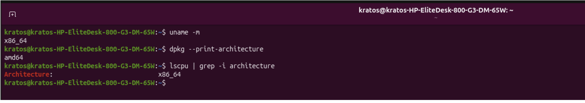
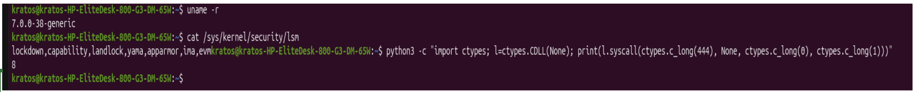

This markdown file consist of some of the checks you need to run on your machine to ensure that openshell features work as expected

⚠️ It is strictly recommended to run this project within a sandbox.⚠️ For the purposes of this exploration I am using a spare machine with the following specs

1) OS - Ubuntu 26.04.1 LTS
2) Processor - Intel i5 
3) RAM - 16 GB
4) Disk space - 512 GB
5) NO GPU

## Support matrix 
Learn more about that at https://docs.nvidia.com/openshell/v0.0.116/reference/support-matrix

Note:- For Openshell to run as expected with all bells and whistles, its important to ensure that your machine has right spec to support it

```
uname -m  
dpkg --print-architecture
```
uname -m = Gives you the hardware architecture
dpkg --print-architecture gives the name Ubuntu’s packages use: amd64 or arm64

Usually x86_64 and amd64 are the same



Then inspect your kernel version and inturn the version of your landlock

⚠️ Note:-  Openshell requries Landlock ABI to be greater than 3 which was introduced in Linux Kernel version 6.2 . So double check both of the versions

```
uname -r

cat /sys/kernel/security/lsm

python3 -c "import ctypes; l=ctypes.CDLL(None); print(l.syscall(ctypes.c_long(444), None, ctypes.c_long(0), ctypes.c_long(1)))"

```


In my machine, the landlock ABI is 8 - which is well above what is required

Check if your desired compute driver is available. For this exploration, I will use docker

```
docker --version. ##Mine is 29.9.0 
```
If you dont docker and would like to install it, simply as AI - its much simpler

### Install openshell

``` 

curl -fsSL https://raw.githubusercontent.com/NVIDIA/OpenShell/main/install.sh -o install.sh
sh  install.sh

```
Note:- The startup of Openshell failed for me due to docker socket usage. Long story short if my login sesion did not have permission to use its socket (/var/run/docker.sock) and was accessible only as root. Add yourself to the group (usemrmod -aG docker) and it only takes effect after your next login - So completely logout i.e. restart your machine. 

Then start the service
```
systemctl --user restart openshell-gateway

```
You can also check the status of your gateway using
```
systemctl --user status openshell-gateway --no-pager
```